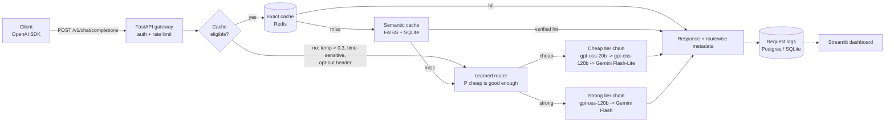
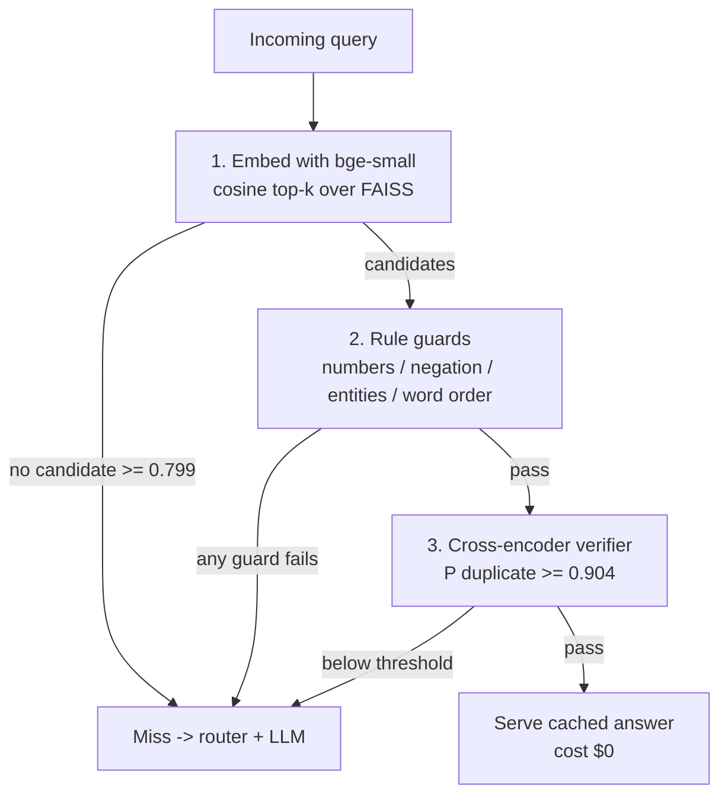

# RouteWise

**A cost-aware, OpenAI-compatible LLM gateway with a learned router and a verified semantic cache.**

Point any OpenAI SDK at RouteWise instead of an LLM provider. For every request it:

1. answers from cache when it is **safe** to (exact match, or a *verified* paraphrase),
2. otherwise **predicts whether a cheap model is good enough** and routes to the cheap or strong tier,
3. calls the provider with retries, a fallback chain and per-model circuit breakers,
4. logs tokens, estimated cost, per-stage latency and every decision.

> Naive semantic caches serve wrong answers to near-miss questions ("Python 3.10 features"
> vs "Python 3.12 features" have cosine similarity 0.93). RouteWise adds rule guards and a
> cross-encoder verifier on top of embedding search, and measures the effect.

| | |
|---|---|
| Live demo | _add your Hugging Face Space link here after deploying (see Deployment)_ |
| Demo video | _add your video link here (free Spaces sleep when idle)_ |
| Technical report | [REPORT.md](REPORT.md) |
| Build log (7 days, with interview Q&A) | [DEVLOG.md](DEVLOG.md) |
| Concepts + interview notes | [LEARNING.md](LEARNING.md) |
| Evaluation reports | [semantic cache](reports/cache_eval.md) · [load test](reports/load_test.md) · router reports are generated into `reports/` when the router pipeline completes |

## Project status

| Part | Status |
|---|---|
| OpenAI-compatible gateway, retries, fallback chains, per-model circuit breakers, rate limiting, logging | Done, verified live |
| Verified semantic cache + evaluation report | Done, verified live |
| Playground + dashboard (Streamlit), one-click Windows launcher | Done, verified live |
| Load test, ConceptBound-Net integration guide | Done |
| Learned router | Code done and tested; training data is being collected within free-tier daily quotas. Until the trained model exists, `model="auto"` uses a length heuristic (logged at start-up) |
| Hugging Face Spaces bundle | Written; not deployed yet |
| Docker Compose stack | Written; not yet run end to end |

---

## Key results

All numbers are produced by scripts in this repo on held-out test splits; see the linked
reports for setup, confidence intervals and caveats.

**Verified semantic cache** ([reports/cache_eval.md](reports/cache_eval.md)), on a deliberately adversarial pair set
(true duplicates mixed only with hard negatives):

| Config (thresholds chosen on dev) | Hit rate | False-hit rate | False-hit rate on near-miss traps |
|---|---|---|---|
| Cosine similarity only | 33.8% | 36.3% | 37.1% |
| Cosine only, tuned to the **same hit rate** as RouteWise | 56.9% | 49.8% | 49.3% |
| **RouteWise: cosine + rule guards + cross-encoder** | **56.9%** | **12.8%** | **7.1%** |

<!-- ROUTER_RESULTS_START -->
**Learned router:** training data is still being collected within free-tier quotas. When the
pipeline finishes, `reports/router_eval.md` (cost saved vs always-strong at >= 95% quality, compared
with always-cheap, a length heuristic, random routing and an oracle) and `reports/router_labels.md`
are generated and summarized here.
<!-- ROUTER_RESULTS_END -->

**Gateway overhead** ([reports/load_test.md](reports/load_test.md)), providers mocked so only RouteWise's own work is
measured, laptop CPU, one worker: **62 ms p50 / 90 ms p95** per request with no contention
(embedding + FAISS + guards + verifier + router + logging); about 14 requests/s at 10 concurrent users.

---

## Architecture



### Request flow inside the semantic cache



| Component | Choice | Why |
|---|---|---|
| API | FastAPI, OpenAI-compatible schema | Any OpenAI SDK works by changing `base_url` |
| Providers | One `httpx` client for Groq, Gemini (OpenAI-compatible endpoints) | Our own retry/fallback logic is the only one in play |
| Reliability | Exponential backoff + full jitter, per-tier fallback chain, per-model circuit breaker | Survive rate limits and outages; skip a failing model instantly without blocking its healthy siblings |
| Rate limiting | Token bucket per API key, atomic Lua script in Redis | Bursts allowed, sustained rate capped, no races across workers |
| Exact cache | Redis, SHA-256 of normalized messages + params, TTL | Repeats are free; system prompt is part of the key |
| Semantic cache | `bge-small-en-v1.5` + FAISS (exact IP search) + SQLite | Runs on a free CPU host; SQLite is the source of truth |
| Verification | spaCy guards + `cross-encoder/quora-distilroberta-base` | Embeddings capture topic, not exact meaning |
| Router | Query embedding + 29 handcrafted features -> LR / LightGBM / MLP | Threshold chosen to keep >= 95% of strong-model quality |
| Logs + dashboard | SQLAlchemy (Postgres or SQLite) + Streamlit | Hit rates, cost vs always-strong, p50/p95 per stage, false-hit audit |

---

## Quickstart

You need Python 3.11+ and a free API key from [Groq](https://console.groq.com) (required) and
[Google AI Studio](https://aistudio.google.com) (optional fallback).

### One-time setup

```bash
git clone https://github.com/marshallmathers0/RouteWise-LLM-gateway.git
cd RouteWise-LLM-gateway
python -m venv .venv
# Windows: .venv\Scripts\activate    macOS/Linux: source .venv/bin/activate
pip install torch==2.15.0 --index-url https://download.pytorch.org/whl/cpu
pip install -r requirements-dev.txt
cp .env.example .env        # Windows: copy .env.example .env -- then add GROQ_API_KEY (+ GEMINI_API_KEY)
```

The first start downloads the embedding model and the cross-encoder (~400 MB) from Hugging Face.

### Option A: one click on Windows

Double-click **`start_demo.bat`**. It starts the gateway (port 8000) and the playground +
dashboard (port 8501) in their own windows, waits until both are ready, and opens
http://localhost:8501. Double-click **`stop_demo.bat`** to stop them.

### Option B: three terminals (any OS)

```bash
python -m uvicorn routewise.main:app --port 8000      # terminal 1: the gateway
python -m streamlit run dashboard/app.py              # terminal 2: playground + dashboard on :8501
python scripts/demo.py                                # terminal 3: scripted demo (paraphrases, traps, routing)
```

### Option C: Docker (gateway + Redis + Postgres + dashboard)

```bash
cp .env.example .env        # then fill in GROQ_API_KEY (and optionally GEMINI_API_KEY)
docker compose up --build
```

* Gateway: http://localhost:8000 (interactive docs at `/docs`)
* Playground + dashboard: http://localhost:8501

(The compose file is written but has not yet been run end to end.)

### Do I need Redis?

No. Without Redis the gateway logs a warning at start-up and:

* turns off the **exact** cache (the only part stored in Redis);
* keeps rate limiting and circuit-breaker state in process memory;
* keeps the **semantic** cache fully working: it stores entries in a local SQLite file
  (`data/semantic_cache.db`) and searches them with an in-memory FAISS index. Repeated and
  paraphrased questions are therefore still answered from cache (shown as `semantic_hit`).

With Redis (`REDIS_URL` in `.env`, or Docker), identical repeats become `exact_hit` in about a
millisecond, and limits/breaker state are shared by every gateway worker.

### Using the playground

1. Pick an example pair in the sidebar (e.g. *Direction trap: miles <-> km*), click the first
   question, press **Send**; then the second question, **Send** again.
2. The result shows the cache status and reason, the nearest cached question with its cosine and
   verifier scores, each guard's verdict, the route and router probability, per-stage latency, the
   model and provider used and the estimated cost.
3. A true paraphrase should be a `semantic hit`; a trap should be a `miss` with a reason such as
   `semantic_rejected:guard:word_order`.
4. Turn on *Also ask always-strong* to compare the answer with the strong model (cache off).
5. Open the **Dashboard** tab for hit rates, estimated cost versus always-strong, latency per stage,
   route mix, fallbacks/errors and the false-hit audit table.

Tip: send `temperature: 0`. Requests above 0.3, or without a temperature, are deliberately never cached.

---

## Using it from the OpenAI SDK

```python
from openai import OpenAI

client = OpenAI(base_url="http://localhost:8000/v1", api_key="rw-dev-key")
resp = client.chat.completions.create(
    model="auto",          # let RouteWise route; or "cheap", "strong", or an explicit model name
    temperature=0,         # requests above 0.3 (or without a temperature) are never cached
    messages=[{"role": "user", "content": "Which city is India's capital?"}],
)
print(resp.choices[0].message.content)
print(resp.model_extra["routewise"])   # route, router_prob, cache_status, matched_query, similarity,
                                       # verifier_score, latency_ms per stage, estimated_cost_usd, ...
```

Useful request options:

| Option | Effect |
|---|---|
| `model="auto"` | Learned router picks the tier |
| `model="cheap"` / `"strong"` / `"openai/gpt-oss-120b"` | Bypass the router |
| header `X-RouteWise-Cache: off` (or `Cache-Control: no-cache`) | Skip both caches |
| `response_format={"type": "json_object"}` | Passed through; JSON answers get their own cache keys |
| `stream=True` | Supported as *buffered* SSE (the answer is complete before streaming starts) |

---

## Reproducing the evaluations

| Step | Command | Output |
|---|---|---|
| Cache ablation (Phase 3) | `make eval-cache` | `reports/cache_eval.md`, figures |
| Router queries (Phase 4) | `make router-queries` | `data/router/queries.jsonl` (1,000 queries) |
| Collect answers (Phase 4) | `make collect` | `data/router/responses.jsonl` (resumable, rate-limited) |
| Judge + labels (Phase 4) | `make label` | `data/router/labels.jsonl`, `reports/router_labels.md` |
| Train router (Phase 5) | `make train-router` | `artifacts/router.joblib` |
| Evaluate router (Phase 5) | `make eval-router` | `reports/router_eval.md`, figures |
| Load test (Phase 7) | `make load-test` | `reports/load_test.md` |
| Tests | `make test` (fast) / `make test-all` (+ real models) | |

No `make` on Windows? Each target is a single `python -m ...` command; copy it from the
[Makefile](Makefile). The collected answers, judgments and labels are committed, so
`make train-router && make eval-router` reproduce the router results **without API keys**.

---

## Configuration

* **Secrets and infrastructure** come from environment variables (`.env`, see [.env.example](.env.example)):
  `GROQ_API_KEY`, `GEMINI_API_KEY`, `OPENROUTER_API_KEY`, `ROUTEWISE_API_KEYS`, `REDIS_URL`, `DATABASE_URL`.
* **Behaviour** lives in [config/routewise.yaml](config/routewise.yaml): providers, tier fallback chains and
  per-model request params, the price table (USD per 1M tokens, used for **estimated** costs), retry / breaker /
  rate-limit settings, cache thresholds (each semantic-cache stage can be switched off), and the router artifact path.

---

## Deployment (free): Hugging Face Spaces

One Docker container serves both the gateway (internal) and the Streamlit playground +
dashboard (public, port 7860). Why Spaces and not Render's free tier: RouteWise loads two
transformer models plus spaCy at startup; the gateway process measured **~1.06 GB resident**
on Windows after a few requests, about twice Render's 512 MB free instance. A free CPU Space has 16 GB.

1. Build the cold-start data once (uses your API keys, about 100 requests):
   `python scripts/build_demo_data.py`
2. Assemble the Space files: `python scripts/prepare_hf_space.py` (writes `build/hf_space/`)
3. Create a new Space at huggingface.co/new-space: SDK **Docker**, hardware **CPU basic (free)**.
4. In the Space's *Settings -> Variables and secrets*, add `GROQ_API_KEY` (required),
   `GEMINI_API_KEY` (optional fallback) and `ROUTEWISE_API_KEYS` (any string, e.g. `rw-demo-key`).
5. Push:
   ```bash
   cd build/hf_space
   git init && git lfs install
   git remote add origin https://huggingface.co/spaces/<your-username>/routewise
   git add . && git commit -m "Deploy RouteWise"
   git push -u origin main      # use a Hugging Face access token with write scope as the password
   ```
6. The first build takes ~10 minutes. Free Spaces sleep after inactivity and take ~1 minute to wake,
   so record a short demo video for your resume and link it at the top of this README.

The Space has no Redis (exact cache off, in-memory rate limits) and its disk resets on
restart: the semantic cache and dashboard start from the pre-generated demo data.

---

## Project layout

```
routewise/      api/ (FastAPI app, schemas) · core/ (config, pricing, pipeline) · providers/ (OpenAI-compatible
                client, mock) · cache/ (exact, semantic, guards, models, store, eligibility) · router/ (features,
                learned router, baselines) · reliability/ (retry, fallback, circuit breaker, rate limiter) · storage/
eval/           cache eval, router data pipeline (queries, collect, label), router train/eval, load test
dashboard/      Streamlit playground + dashboard
scripts/        demo.py, simulate_traffic.py, build_demo_data.py, prepare_hf_space.py
reports/        generated evaluation reports + figures (committed)
docs/           integration_conceptbound.md
tests/          pytest suite (mocked providers; `-m slow` tests load the real models)
```

## Integration

[docs/integration_conceptbound.md](docs/integration_conceptbound.md) shows how the ConceptBound-Net RAG project
sends its LLM calls through RouteWise (one small provider class, JSON mode preserved).

## Limitations

See [REPORT.md](REPORT.md#limitations). In short: costs are estimates from list prices (free tiers cost $0),
judge-based labels carry LLM-judge bias, the near-miss trap set was LLM-drafted and is small, the verifier was
trained on Quora questions (so its Quora results are optimistic), and everything is English-only.

# commads to run the frontend 
 
 terminal 1: .\.venv\Scripts\python -m uvicorn routewise.main:app --port 8000

 terminal 2: .\.venv\Scripts\python -m streamlit run dashboard\app.py 

Then open http://localhost:8501.
