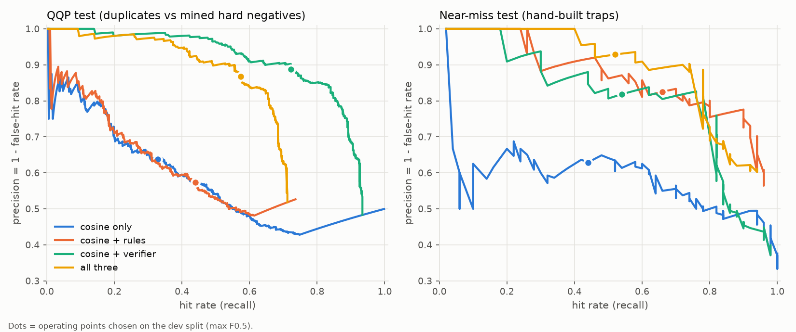
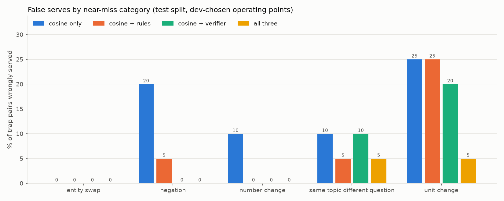

# Semantic cache evaluation

_Generated by `python -m eval.cache_eval` - do not edit by hand. All numbers come from this run._

## Setup

* **Pairs:** 2,300 total - QQP duplicates 1000, QQP mined hard negatives 1000, near-miss traps 200, near-miss paraphrases 100. Split 50/50 into dev (choose thresholds) and test (report), stratified by source/category/label.
* **Embedder:** `BAAI/bge-small-en-v1.5`; **verifier:** `cross-encoder/quora-distilroberta-base`; **guards:** numbers, negation, entities (spaCy `en_core_web_sm`), word order.
* **Stage-1 candidate threshold:** cosine >= **0.799** (keeps 95% of dev duplicates). Verifier configs use it as their loose recall filter, then tune the verifier threshold.
* **Operating point** per config: the knob value maximizing **F0.5 on dev** (precision weighted 2x: a false hit serves a wrong answer, a miss only costs one LLM call).
* The pair mix is deliberately **adversarial** (only hard negatives, no easy ones), so absolute false-hit rates are a worst case - typical traffic is far easier.

## Headline (test split)

| Config | Threshold(s) | Hit rate (all) | False-hit rate (all) | Hit rate (near-miss) | False-hit rate (near-miss) | Hit rate (QQP) | False-hit rate (QQP) |
|---|---|---|---|---|---|---|---|
| cosine only | cos>=0.941 | 33.8% | 36.3% | 44.0% | 37.1% | 32.8% | 36.2% |
| cosine + rules | cos>=0.909 | 46.0% | 40.3% | 66.0% | 17.5% | 44.0% | 42.7% |
| cosine + verifier | cos>=0.799, ver>=0.920 | 70.5% | 11.8% | 54.0% | 18.2% | 72.2% | 11.3% |
| all three | cos>=0.799, ver>=0.904 | 56.9% | 12.8% | 52.0% | 7.1% | 57.4% | 13.3% |
| cosine only, **matched hit rate** | cos>=0.899 | 56.9% | 49.8% | 76.0% | 49.3% | 55.0% | 49.8% |

95% bootstrap CIs on the test split:

| Config | All: hit rate | All: false-hit rate | Near-miss: served (wrong) | Near-miss: false-hit rate |
|---|---|---|---|---|
| cosine only | 33.8% [30.2%, 37.6%] | 36.3% [31.3%, 41.7%] | 35 (13) | 37.1% [20.7%, 54.1%] |
| cosine + rules | 46.0% [42.0%, 49.9%] | 40.3% [35.9%, 44.9%] | 40 (7) | 17.5% [6.5%, 30.6%] |
| cosine + verifier | 70.5% [66.9%, 74.2%] | 11.8% [8.9%, 14.9%] | 33 (6) | 18.2% [6.1%, 32.5%] |
| all three | 56.9% [52.8%, 61.1%] | 12.8% [9.4%, 16.2%] | 28 (2) | 7.1% [0.0%, 17.9%] |

The near-miss set is small, so its intervals are wide and overlap between neighbouring configs.

**Reading it:** on the near-miss traps, naive cosine caching (at its own best threshold) had a 37.1% false-hit rate at a 44.0% hit rate; the full verified cache had 7.1% while keeping 52.0% of paraphrase hits. Tuning cosine alone to the same hit rate as the full system leaves 49.3% false hits on near-misses.

## Chosen production operating point

**All three stages: cosine >= 0.799, guards on, verifier >= 0.904** (written to `config/routewise.yaml`). Why this and not `cosine + verifier`, which wins on QQP:

* On QQP, `cosine + verifier` serves more duplicates (72.2% vs 57.4%) at a similar false-hit rate (11.3% vs 13.3%, overlapping CIs). But the verifier was trained on QQP (caveat 1), so this comparison flatters it.
* On the near-miss traps - data the verifier never saw - it alone lets through 18.2% wrong answers; adding the guards cuts that to 7.1%, mostly unit/direction swaps and negations it scores as duplicates.
* The guards and the verifier fail differently (the guards are lexical and blunt, the verifier is semantic but fooled by swaps), which is why stacking them helps on unseen data.
* The price is hit rate: the guards reject some true QQP duplicates (table below), partly because QQP's 'same intent' duplicates often differ in a number or entity ("best laptop under 25k" vs "best laptop under 25k in India"), where serving one cached answer isn't actually safe. For a cache, wrong answers are worse than misses, so we accept that.

## Near-miss categories (test)

Share of each category's trap pairs that were wrongly served (lower is better). The `paraphrase` row is the hit rate on true paraphrases (higher is better).

| Category | cosine only | cosine + rules | cosine + verifier | all three |
|---|---|---|---|---|
| entity swap | 0.0% | 0.0% | 0.0% | 0.0% |
| negation | 20.0% | 5.0% | 0.0% | 0.0% |
| number change | 10.0% | 0.0% | 0.0% | 0.0% |
| paraphrase | 44.0% | 66.0% | 54.0% | 52.0% |
| same topic different question | 10.0% | 5.0% | 10.0% | 5.0% |
| unit change | 25.0% | 25.0% | 20.0% | 5.0% |

## What each guard does (stage-1 candidates, dev + test)

`neg caught` = true non-duplicates the guard rejects (good). `pos lost` = true duplicates it wrongly rejects (each costs one cache miss).

| Guard | QQP neg caught | QQP pos lost | Near-miss neg caught | Near-miss pos lost |
|---|---|---|---|---|
| numbers | 83/1000 | 66/940 | 37/161 | 0/99 |
| negation | 45/1000 | 38/940 | 36/161 | 0/99 |
| entities | 220/1000 | 145/940 | 21/161 | 2/99 |
| word_order | 2/1000 | 2/940 | 10/161 | 0/99 |

## Latency overhead (CPU, single request)

| Step | p50 (ms) | p95 (ms) |
|---|---|---|
| embed 1 query | 11.0 | 15.51 |
| guards 1 pair | 5.69 | 7.7 |
| verifier 1 pair | 17.09 | 21.48 |
| verifier batch 5 | 71.77 | 109.2 |

A full lookup with top-k=5 costs roughly embed + guards x5 + one verifier batch of 5 ≈ 111 ms p50 (upper bound: guards usually prune candidates before the verifier). An LLM call is typically 300-3000 ms.

## Caveats (read these)

1. **Verifier leakage on QQP.** The cross-encoder was trained on Quora duplicate questions, so its QQP numbers are optimistic. The near-miss set (not from QQP) is the fairer test of the verifier.
2. **QQP label noise.** An LLM-assisted audit (Claude, not a human) of 40 sampled hard negatives judged 4 to be real duplicates and 5 borderline (`eval/data/qqp_hard_negative_audit.jsonl`), i.e. roughly 10-22% of these 'negatives' are mislabeled. That puts a floor under every config's QQP false-hit rate.
3. **The near-miss set was drafted by an LLM** and its labels have **not yet been human-verified** (`eval/data/near_miss_pairs.jsonl`, `verified: false`). It is also small (100 test pairs): see the CIs.
4. **Same author for traps and guards.** The near-miss categories and the rule guards were designed by the same process, so the guards are likely to look better on this set than on independent traps. Human-written or crowd-sourced near-misses would be a stronger test.
5. **The guards were revised twice.** After the first evaluation run, error analysis found bugs ("one" parsed as a number, case-sensitive entity matching, every proper noun treated as an entity); later the playground showed spaCy tagging "Convert 5 miles" as a PERSON, so digit-bearing entities are now ignored. The fixes are generic, but the first error analysis looked at pairs from both splits, so test numbers may be slightly optimistic.
6. **Thresholds are not universal.** They depend on the embedder; re-run this eval after changing models.
